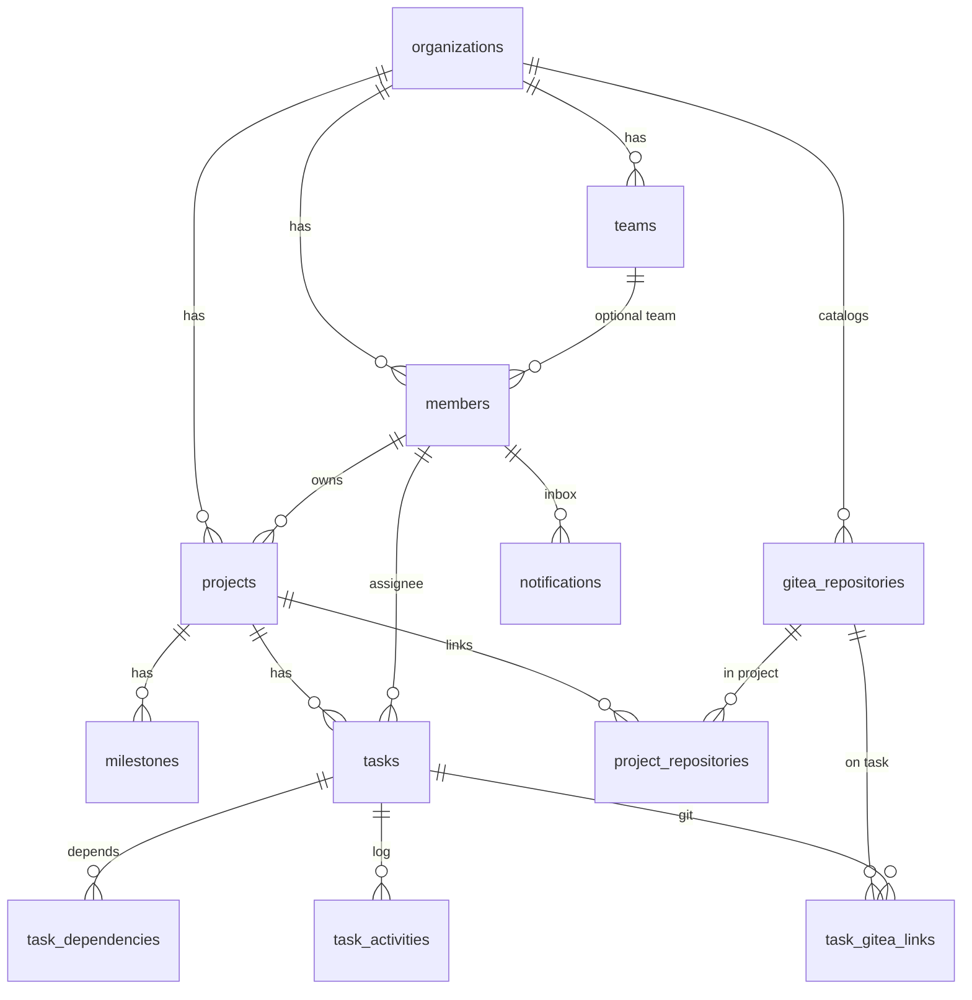

# My Work OS V1 — Database

Lock: [`my-work-os-v1.md`](./my-work-os-v1.md). API: [`my-work-os-v1-api.md`](./my-work-os-v1-api.md).

**12 tables.** Do not copy AppFlowy or Gitea catalogs.

```
                    MY WORK OS DB
                         │
       ┌─────────────────┼─────────────────┐
       │                 │                 │
   Organization        Project            Team
       │                 │                 │
       │              Milestone          Member
       │                 │
       │                Task
       │                 │
       │        ┌────────┼─────────┐
       │        │        │         │
       │   Dependency Activity  GiteaLink
```

---

## 1. ERD

```
organizations
    ├── teams
    │     └── members.team_id (nullable, one team in V1)
    └── members (UNIQUE org + email)
          ▲
          │ owner_id / assignee_id / reporter_id / actor_id
projects
    ├── milestones
    ├── tasks
    │     ├── task_dependencies
    │     ├── task_activities
    │     └── task_gitea_links ── gitea_repositories
    └── project_repositories ── gitea_repositories
notifications → members
```



---

## 2. Conventions

- PK `UUID`, default `gen_random_uuid()`
- Enums stored **UPPERCASE**, `VARCHAR` + `CHECK`
- UI task id = `projects.key || '-' || tasks.task_number`
- `members` is the person. Login uses `members.email` + `password_hash` (needed for V1 auth; still 12 entity tables)
- One member belongs to **one team** (`team_id` nullable). No `team_members` junction in V1
- Cycle check for dependencies in **service**, not only SQL

```sql
CREATE EXTENSION IF NOT EXISTS pgcrypto;
```

---

## 3. SQL (implement this)

```sql
CREATE TABLE organizations (
    id UUID PRIMARY KEY DEFAULT gen_random_uuid(),
    name VARCHAR(200) NOT NULL,
    slug VARCHAR(100) NOT NULL UNIQUE,
    description TEXT,
    created_at TIMESTAMPTZ NOT NULL DEFAULT now(),
    updated_at TIMESTAMPTZ NOT NULL DEFAULT now()
);

CREATE TABLE teams (
    id UUID PRIMARY KEY DEFAULT gen_random_uuid(),
    organization_id UUID NOT NULL REFERENCES organizations (id),
    name VARCHAR(200) NOT NULL,
    description TEXT,
    created_at TIMESTAMPTZ NOT NULL DEFAULT now(),
    updated_at TIMESTAMPTZ NOT NULL DEFAULT now()
);

CREATE INDEX teams_organization_id_idx ON teams (organization_id);

CREATE TABLE members (
    id UUID PRIMARY KEY DEFAULT gen_random_uuid(),
    organization_id UUID NOT NULL REFERENCES organizations (id),
    team_id UUID REFERENCES teams (id),
    name VARCHAR(200) NOT NULL,
    email VARCHAR(320) NOT NULL,
    password_hash TEXT NOT NULL,
    avatar_url TEXT,
    role VARCHAR(30) NOT NULL DEFAULT 'MEMBER'
        CHECK (role IN ('OWNER', 'ADMIN', 'MANAGER', 'MEMBER', 'VIEWER')),
    status VARCHAR(30) NOT NULL DEFAULT 'ACTIVE'
        CHECK (status IN ('ACTIVE', 'DISABLED')),
    created_at TIMESTAMPTZ NOT NULL DEFAULT now(),
    updated_at TIMESTAMPTZ NOT NULL DEFAULT now(),
    UNIQUE (organization_id, email)
);

CREATE INDEX members_org_idx ON members (organization_id);

CREATE TABLE projects (
    id UUID PRIMARY KEY DEFAULT gen_random_uuid(),
    organization_id UUID NOT NULL REFERENCES organizations (id),
    key VARCHAR(20) NOT NULL,
    name VARCHAR(200) NOT NULL,
    description TEXT,
    owner_id UUID REFERENCES members (id),
    status VARCHAR(30) NOT NULL DEFAULT 'PLANNING'
        CHECK (status IN ('PLANNING', 'ACTIVE', 'ON_HOLD', 'COMPLETED', 'ARCHIVED')),
    priority VARCHAR(20) NOT NULL DEFAULT 'MEDIUM'
        CHECK (priority IN ('LOW', 'MEDIUM', 'HIGH', 'URGENT')),
    start_date DATE,
    due_date DATE,
    created_at TIMESTAMPTZ NOT NULL DEFAULT now(),
    updated_at TIMESTAMPTZ NOT NULL DEFAULT now(),
    UNIQUE (organization_id, key),
    CHECK (key ~ '^[A-Z][A-Z0-9]{1,15}$')
);

CREATE INDEX projects_org_idx ON projects (organization_id);

CREATE TABLE milestones (
    id UUID PRIMARY KEY DEFAULT gen_random_uuid(),
    project_id UUID NOT NULL REFERENCES projects (id) ON DELETE CASCADE,
    name VARCHAR(200) NOT NULL,
    description TEXT,
    status VARCHAR(30) NOT NULL DEFAULT 'PLANNED'
        CHECK (status IN ('PLANNED', 'ACTIVE', 'DONE')),
    start_date DATE,
    due_date DATE,
    created_at TIMESTAMPTZ NOT NULL DEFAULT now(),
    updated_at TIMESTAMPTZ NOT NULL DEFAULT now()
);

CREATE INDEX milestones_project_id_idx ON milestones (project_id);

CREATE TABLE tasks (
    id UUID PRIMARY KEY DEFAULT gen_random_uuid(),
    project_id UUID NOT NULL REFERENCES projects (id) ON DELETE CASCADE,
    milestone_id UUID REFERENCES milestones (id),
    parent_task_id UUID REFERENCES tasks (id),
    task_number INTEGER NOT NULL,
    title VARCHAR(500) NOT NULL,
    description TEXT,
    status VARCHAR(30) NOT NULL DEFAULT 'BACKLOG'
        CHECK (status IN (
            'BACKLOG', 'PLANNED', 'IN_PROGRESS', 'REVIEW',
            'BLOCKED', 'DONE', 'CANCELLED'
        )),
    priority VARCHAR(20) NOT NULL DEFAULT 'MEDIUM'
        CHECK (priority IN ('LOW', 'MEDIUM', 'HIGH', 'URGENT')),
    assignee_id UUID REFERENCES members (id),
    reporter_id UUID REFERENCES members (id),
    start_date DATE,
    due_date DATE,
    estimate_hours NUMERIC(8,2),
    actual_hours NUMERIC(8,2),
    completed_at TIMESTAMPTZ,
    appflowy_page_id TEXT,
    document_url TEXT,
    created_at TIMESTAMPTZ NOT NULL DEFAULT now(),
    updated_at TIMESTAMPTZ NOT NULL DEFAULT now(),
    UNIQUE (project_id, task_number),
    CHECK (parent_task_id IS DISTINCT FROM id)
);

CREATE INDEX tasks_project_status_idx ON tasks (project_id, status);
CREATE INDEX tasks_assignee_idx ON tasks (assignee_id);
CREATE INDEX tasks_parent_idx ON tasks (parent_task_id);

CREATE TABLE task_number_seq (
    project_id UUID PRIMARY KEY REFERENCES projects (id) ON DELETE CASCADE,
    last_number INTEGER NOT NULL DEFAULT 0
);

CREATE TABLE task_dependencies (
    id UUID PRIMARY KEY DEFAULT gen_random_uuid(),
    task_id UUID NOT NULL REFERENCES tasks (id) ON DELETE CASCADE,
    depends_on_task_id UUID NOT NULL REFERENCES tasks (id) ON DELETE CASCADE,
    type VARCHAR(30) NOT NULL DEFAULT 'BLOCKS' CHECK (type = 'BLOCKS'),
    created_at TIMESTAMPTZ NOT NULL DEFAULT now(),
    UNIQUE (task_id, depends_on_task_id),
    CHECK (task_id <> depends_on_task_id)
);

CREATE TABLE task_activities (
    id UUID PRIMARY KEY DEFAULT gen_random_uuid(),
    task_id UUID NOT NULL REFERENCES tasks (id) ON DELETE CASCADE,
    actor_id UUID REFERENCES members (id),
    activity_type VARCHAR(50) NOT NULL,
    field_name VARCHAR(100),
    old_value JSONB,
    new_value JSONB,
    message TEXT,
    created_at TIMESTAMPTZ NOT NULL DEFAULT now()
);

CREATE INDEX task_activities_task_idx ON task_activities (task_id, created_at DESC);

CREATE TABLE gitea_repositories (
    id UUID PRIMARY KEY DEFAULT gen_random_uuid(),
    organization_id UUID NOT NULL REFERENCES organizations (id),
    gitea_instance_url TEXT NOT NULL,
    gitea_repo_id BIGINT NOT NULL,
    owner_name VARCHAR(200) NOT NULL,
    repo_name VARCHAR(200) NOT NULL,
    html_url TEXT NOT NULL,
    created_at TIMESTAMPTZ NOT NULL DEFAULT now(),
    UNIQUE (gitea_instance_url, gitea_repo_id)
);

CREATE TABLE project_repositories (
    project_id UUID NOT NULL REFERENCES projects (id) ON DELETE CASCADE,
    repository_id UUID NOT NULL REFERENCES gitea_repositories (id) ON DELETE CASCADE,
    PRIMARY KEY (project_id, repository_id)
);

CREATE TABLE task_gitea_links (
    id UUID PRIMARY KEY DEFAULT gen_random_uuid(),
    task_id UUID NOT NULL REFERENCES tasks (id) ON DELETE CASCADE,
    repository_id UUID REFERENCES gitea_repositories (id),
    issue_id BIGINT,
    pull_request_id BIGINT,
    branch_name VARCHAR(500),
    issue_url TEXT,
    pull_request_url TEXT,
    created_at TIMESTAMPTZ NOT NULL DEFAULT now()
);

CREATE INDEX task_gitea_links_task_idx ON task_gitea_links (task_id);
CREATE INDEX task_gitea_links_pr_idx ON task_gitea_links (repository_id, pull_request_id);

CREATE TABLE notifications (
    id UUID PRIMARY KEY DEFAULT gen_random_uuid(),
    member_id UUID NOT NULL REFERENCES members (id) ON DELETE CASCADE,
    type VARCHAR(50) NOT NULL,
    title VARCHAR(500) NOT NULL,
    message TEXT,
    entity_type VARCHAR(50),
    entity_id UUID,
    read_at TIMESTAMPTZ,
    created_at TIMESTAMPTZ NOT NULL DEFAULT now()
);

CREATE INDEX notifications_member_idx ON notifications (member_id, created_at DESC);

CREATE TABLE webhook_receipts (
    delivery_id TEXT PRIMARY KEY,
    event TEXT NOT NULL,
    processed_at TIMESTAMPTZ NOT NULL DEFAULT now()
);

CREATE TABLE gitea_credentials (
    organization_id UUID PRIMARY KEY REFERENCES organizations (id) ON DELETE CASCADE,
    gitea_instance_url TEXT NOT NULL,
    token_encrypted TEXT NOT NULL,
    created_at TIMESTAMPTZ NOT NULL DEFAULT now(),
    updated_at TIMESTAMPTZ NOT NULL DEFAULT now()
);
```

`task_number_seq`, `webhook_receipts`, `gitea_credentials` are **infra** (not product entities). Token is **encrypted**, never stored plain. `webhook_receipts` is idempotency only.

Product entities remain the 12 listed in the lock file.

---

## 4. Activity types (V1)

| activity_type | field_name | example message |
|---|---|---|
| `CREATED` | | Task created |
| `STATUS_CHANGED` | `status` | `IN_PROGRESS → REVIEW` |
| `ASSIGNED` | `assignee_id` | Assigned to Engineer A |
| `PRIORITY_CHANGED` | `priority` | |
| `COMMENTED` | | |
| `DEPENDENCY_ADDED` | | Depends on P5G-1014 |
| `GITEA_LINKED` | | |
| `GITEA_PR_OPENED` | | Pull Request #87 opened |
| `GITEA_PR_MERGED` | | Pull Request #87 merged |
| `GITEA_ISSUE_CLOSED` | | |
| `AUTOMATION` | `status` | PR merged → DONE |

`old_value` / `new_value` JSONB e.g. `"IN_PROGRESS"` / `"REVIEW"` or `{ "id": "...", "name": "Tuan" }`.  
`actor_id` NULL = system (webhook).

---

## 5. Derived (do not persist)

| UI | Formula |
|---|---|
| Display id | `key || '-' || task_number` |
| Project % | done / (all except `CANCELLED`) |
| Workload | sum `estimate_hours` of assignee tasks in `PLANNED\|IN_PROGRESS\|REVIEW\|BLOCKED` / 40 |

---

## 6. Signup

Insert `organizations` + `members` (`OWNER`) in one transaction. Optional team `General`.
